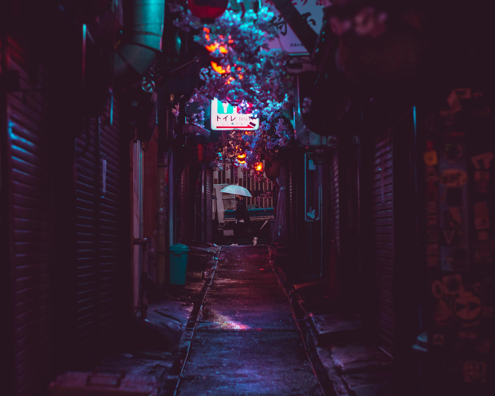

<!-- Hero photo: a relative  is bundled by Vite (frontmatter `background`/`image` paths are not). -->

<div class="absolute inset-0" style="background: color-mix(in srgb, var(--slidev-bg) 68%, transparent)" />

<div class="relative z-10">

# Tokyo Night Storm

A [Tokyo Night](https://github.com/enkia/tokyo-night-vscode-theme) inspired theme for [Slidev](https://sli.dev/)

</div>

<div class="abs-br m-6 text-sm relative z-10">
Photo by <a href="https://unsplash.com/photos/9gtODWv-L5I">Marek Okon</a> on Unsplash
</div>

---

# What is Slidev?

`Slidev` is a slide maker and presentation tool designed for developers. It includes the following features:

- 📝 **Text-based** - focus on your content with Markdown, then style it later
- 🎨 **Themable** - themes can be shared and reused as npm packages
- 🧑‍💻 **Developer Friendly** - code highlighting, live coding with autocompletion
- 🤹 **Interactive** - embed Vue components to enhance your expressions
- 🎥 **Recording** - built-in recording and camera view
- 📤 **Portable** - export to PDF, PPTX, PNGs, or even a hostable SPA
- 🛠 **Hackable** - virtually anything that's possible on a webpage is possible in Slidev

<br>
<br>

Read more about [Why Slidev?](https://sli.dev/guide/why)

---

# Navigation

Hover on the bottom-left corner to see the navigation's controls panel

## Keyboard Shortcuts

| Shortcut | Purpose |
| --- | --- |
| <kbd>space</kbd> / <kbd>tab</kbd> / <kbd>right</kbd> | next animation or slide |
| <kbd>left</kbd>  / <kbd>shift</kbd><kbd>space</kbd> | previous animation or slide |
| <kbd>up</kbd> | previous slide |
| <kbd>down</kbd> | next slide |

---

# Code

```c {max-height:"100%"}
float Q_rsqrt( float number )
{
	long i;
	float x2, y;
	const float threehalfs = 1.5F;

	x2 = number * 0.5F;
	y  = number;
	i  = * ( long * ) &y;                       // evil floating point bit level hacking
	i  = 0x5f3759df - ( i >> 1 );               // what the fxxk?
	y  = * ( float * ) &i;
	y  = y * ( threehalfs - ( x2 * y * y ) );   // 1st iteration
//	y  = y * ( threehalfs - ( x2 * y * y ) );   // 2nd iteration, this can be removed

	return y;
}
```

---
layout: center
class: "text-center"
---

# Heading 1
## Heading 2
### Heading 3
#### Heading 4
##### Heading 5
###### Heading 6

lorem ipsum dolor sit _amet_

---
layout: section
---

# Section

A new chapter begins

---
layout: fact
---

# 60%

of the time, it works every time

---
layout: statement
---

# One bold statement

---
layout: quote
---

# "Neon rain on the streets of Shinjuku."

Tokyo Night Storm

---
layout: two-cols
---

# Left

- Storm
- Neon

::right::

# Right

- Rain
- Midnight

---
layout: default
---

# Images

Slidev's `image-right` and `image-left` layouts work out of the box.

<div class="grid grid-cols-2 gap-8 items-center">

- Neon-soaked city streets are a natural fit for Tokyo Night's palette
- Photo by [Marek Okon](https://unsplash.com/photos/9gtODWv-L5I) on Unsplash


</div>
